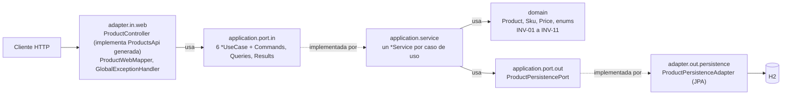

<!-- Generado con /documentacion-final desde specs/, docs/tecnica/ y comandos ejecutados el 2026-10-18. No editar a mano. -->

# Catálogo de Productos: documentación final

Entrega de la solución `catalogo-productos`, desarrollada con **Spec-Driven Development (SDD)**:
[`specs/`](../../specs/) es la fuente única de verdad, y este documento la resume y enlaza.
Estado verificado en `master` sobre `dcc968d` (merge del PR #4), contrato **1.1.0**.

| Documento | Contenido |
| :--- | :--- |
| Este README | Resumen, ejecución, arquitectura, funcionalidades, decisiones, calidad, proceso y limitaciones |
| [matriz-trazabilidad.md](matriz-trazabilidad.md) | RF → US → CA → INV → operación → caso de uso → servicio → pruebas |
| [evidencia/](evidencia/) | Salida de `spec_lint`, `spec_sync` y resumen de `target/surefire-reports` |
| [docs/tecnica/](../tecnica/README.md) | Documentación técnica detallada (generada con `/documentar`) |

## 1. Solución y alcance

**Propósito** ([vision.md §1](../../specs/vision.md)): mantener un catálogo centralizado y confiable de
productos, de modo que solo los productos completos y aprobados estén disponibles para la venta.

**Alcance** ([vision.md §3](../../specs/vision.md)): registrar productos en borrador, actualizarlos mientras no
estén descontinuados, activarlos cuando cumplen los requisitos mínimos, descontinuarlos y consultarlos o
listarlos por estado y categoría. El ciclo de vida es `DRAFT → ACTIVE → DISCONTINUED`
([product-lifecycle.md](../../specs/domain/product-lifecycle.md)), y las categorías son un catálogo cerrado de
seis valores ([catalogs.md](../../specs/domain/catalogs.md)).

**Fuera de alcance en este release** ([vision.md §4](../../specs/vision.md)):

- Control de inventario o stock.
- Precios por cliente, descuentos o múltiples monedas.
- Imágenes del producto.
- Eliminación física de productos (un producto nunca se borra: se descontinúa, INV-10).
- Seguridad (autenticación y autorización), según [API-GUIDELINES.md](../../specs/api/API-GUIDELINES.md).

## 2. Cómo ejecutar

**Requisitos:**

| Elemento | Versión | Fuente |
| :--- | :--- | :--- |
| Java | 25 | `pom.xml` (`java.version`), ADR-0006 |
| Maven | Incluido como wrapper (`mvnw`, `mvnw.cmd`); no requiere instalación | Repositorio |
| Python + PyYAML | Python 3 y `pip install pyyaml` | `tools/spec_lint.py`, `tools/spec_sync.py` |
| Postman CLI (opcional) | — | Solo para ejecutar las colecciones (ADR-0012) |

**Comandos** (en Windows, `.\mvnw.cmd` en lugar de `./mvnw`):

| Acción | Comando |
| :--- | :--- |
| Validar specs y contrato | `python tools/spec_lint.py` |
| Verificar specs ↔ implementación | `python tools/spec_sync.py --md docs/sync-report.md` |
| Regenerar la API desde el contrato | `./mvnw clean generate-sources` |
| Compilar y probar | `./mvnw clean test` |
| Ejecutar la aplicación | `./mvnw spring-boot:run` (puerto 8080) |

**Con la aplicación en ejecución:**

| Recurso | URL / uso |
| :--- | :--- |
| API REST | `http://localhost:8080/api/v1/products` ([contrato](../../specs/api/catalog-openapi.yaml)) |
| Swagger UI (ADR-0008) | `http://localhost:8080/swagger-ui.html`, muestra el contrato autoritativo |
| Consola H2 (ADR-0005, solo desarrollo) | `http://localhost:8080/h2-console`, JDBC URL `jdbc:h2:mem:catalogo`, usuario `sa`, sin contraseña |
| Colección Postman de flujo (ADR-0012) | `postman collection run postman/catalogo-productos-flujo.postman_collection.json --env-var baseUrl=http://localhost:8080` |
| Colección Postman de contrato (ADR-0012) | `postman/catalogo-productos-contrato.postman_collection.json`, regenerada desde el contrato 1.1.0 |

La base H2 es en memoria: los datos se pierden al reiniciar.

## 3. Arquitectura

Monolito con **arquitectura hexagonal** (ADR-0001): el dominio es Java puro, la aplicación define puertos de
entrada (`*UseCase`) y de salida (`ProductPersistencePort`), y los adaptadores traducen HTTP y JPA. El dominio
nunca sale de `application`: el controlador recibe `ProductResult`.

Detalle completo (dependencias permitidas, modelos por frontera, paquetes y secuencias):
[architecture.md](../../specs/architecture/architecture.md), [docs/tecnica/arquitectura.md](../tecnica/arquitectura.md)
y [docs/tecnica/diagramas.md](../tecnica/diagramas.md).

## 4. Funcionalidades

Todas implementadas y probadas: cada criterio de aceptación tiene al menos una prueba `USxx_CAyy`
([matriz](matriz-trazabilidad.md)).

| RF | Historia | operationId | Método y ruta | Criterios | Estado |
| :--- | :--- | :--- | :--- | :---: | :--- |
| RF-01 Registrar producto | [US01](../../specs/user-stories/US01-registrar-producto.md) | `registerProduct` | `POST /api/v1/products` | 6/6 | Implementado y probado |
| RF-02 Actualizar producto | [US02](../../specs/user-stories/US02-actualizar-producto.md) | `updateProduct` | `PATCH /api/v1/products/{productId}` | 5/5 | Implementado y probado |
| RF-03 Activar producto | [US03](../../specs/user-stories/US03-activar-producto.md) | `activateProduct` | `POST /api/v1/products/{productId}/activate` | 3/3 | Implementado y probado |
| RF-04 Descontinuar producto | [US04](../../specs/user-stories/US04-descontinuar-producto.md) | `discontinueProduct` | `POST /api/v1/products/{productId}/discontinue` | 4/4 | Implementado y probado |
| RF-05 Consultar y listar | [US05](../../specs/user-stories/US05-consultar-productos.md) | `getProduct` | `GET /api/v1/products/{productId}` | 2/2 | Implementado y probado |
| RF-05 Consultar y listar | [US05](../../specs/user-stories/US05-consultar-productos.md) | `searchProducts` | `GET /api/v1/products` | 2/2 | Implementado y probado |

Requerimientos: [functional.md](../../specs/requirements/functional.md). Contrato:
[catalog-openapi.yaml](../../specs/api/catalog-openapi.yaml). Errores: HTTP + `code` según
[ADR-0004](../../specs/adr/0004-codigos-de-error.md).

## 5. Decisiones de arquitectura

| ADR | Decisión | Estado |
| :--- | :--- | :--- |
| [0001](../../specs/adr/0001-arquitectura-hexagonal.md) | Arquitectura hexagonal con puertos in/out y modelos por frontera | Aceptado |
| [0002](../../specs/adr/0002-transiciones-como-acciones.md) | Transiciones de estado como acciones (`POST .../activate`) | Aceptado |
| [0003](../../specs/adr/0003-identificador-uuid.md) | Identificador técnico UUID; el SKU es identificador de negocio | Aceptado |
| [0004](../../specs/adr/0004-codigos-de-error.md) | Códigos HTTP de error según el tipo de regla incumplida | Aceptado |
| [0005](../../specs/adr/0005-base-de-datos-h2.md) | Base de datos H2 en memoria con Spring Data JPA (y consola H2 en desarrollo) | Aceptado |
| [0006](../../specs/adr/0006-spring-boot-4.md) | Spring Boot 4.1 en lugar de 3.5 | Aceptado |
| [0007](../../specs/adr/0007-error-interno-generico.md) | Error interno genérico (500 `INTERNAL_ERROR`) | Aceptado |
| [0008](../../specs/adr/0008-swagger-ui-con-contrato.md) | Swagger UI con springdoc mostrando el contrato autoritativo | Aceptado |
| [0009](../../specs/adr/0009-null-explicito-en-requests.md) | Rechazo de null explícito y de cuerpos sin campos en los requests | Aceptado |
| [0010](../../specs/adr/0010-errores-propios-de-spring-mvc.md) | Errores propios de Spring MVC fuera de las operaciones del contrato | Aceptado |
| 0011 | Número reservado, sin ADR ([CHANGELOG](../../specs/CHANGELOG.md)) | — |
| [0012](../../specs/adr/0012-colecciones-postman.md) | Colecciones Postman como verificación complementaria | Aceptado |

## 6. Calidad

Resultados de los comandos ejecutados para esta entrega ([evidencia/](evidencia/)):

| Verificación | Resultado |
| :--- | :--- |
| `python tools/spec_lint.py` | **OK**: contrato v1.1.0, 6 operaciones, 0 errores, 0 advertencias ([salida](evidencia/spec_lint.txt)) |
| `python tools/spec_sync.py --md docs/sync-report.md` | **OK**: 22/22 criterios con prueba, 90 pruebas `USxx_CAyy`, 0 errores, 0 advertencias ([salida](evidencia/spec_sync.txt), [informe](../sync-report.md)) |
| `./mvnw clean test` | **BUILD SUCCESS**: 152 ejecuciones, 0 fallos, 0 errores, 0 omitidas ([resumen](evidencia/surefire-resumen.md)) |

Pruebas por capa (ejecuciones de surefire; los casos parametrizados cuentan por separado):

| Capa | Tipo | Ejecuciones |
| :--- | :--- | ---: |
| Dominio (`domain.model`) | JUnit puro, sin Spring | 50 |
| Aplicación (`application.service`) | JUnit con persistencia en memoria, sin Spring | 32 |
| Web (`adapter.in.web`) | `@WebMvcTest` con los casos de uso simulados | 63 |
| Persistencia (`adapter.out.persistence`) | `@DataJpaTest` sobre H2 | 6 |
| Contexto | `@SpringBootTest` | 1 |
| **Total** | | **152** |

Estrategia de pruebas por capa: [docs/tecnica/pruebas.md](../tecnica/pruebas.md).

## 7. Proceso SDD seguido

| Fase | Qué se hizo | Comandos / prompts | Commits |
| :--- | :--- | :--- | :--- |
| 1. Especificación | Visión, RF, ciclo de vida, catálogos, historias y criterios | — | `spec:` |
| 2. Diseño | Arquitectura, modelo de dominio (INV), ADR, trazabilidad | — | `design:` |
| 3. Contrato | OpenAPI autoritativo, validado con `spec_lint` | `tools/spec_lint.py` | `contract:` |
| 4. Implementación | Dominio y una operación a la vez, con sus pruebas `USxx_CAyy` | `/implementar-primera`, `/implementar` | `feat:`, `test:`, `fix:` |
| 5. Refactorización | Ajustes de estructura guiados por el diseño | `/refactorizar` | `refactor:` |
| 6. Documentación con IA | Documentación técnica, diagramas, sincronización, gestión de cambios y entrega | `/documentar`, `/diagramas`, `/sincronizar`, `/cambio-spec`, `/documentacion-final` | `tooling:`, `docs:` |

Historial de `master` antes de esta entrega: **79 commits** (4 de ellos merges de PR), del 2026-09-26 al 2026-10-18.

| Prefijo | Commits | | Prefijo | Commits |
| :--- | ---: | :--- | :--- | ---: |
| `spec:` | 18 | | `test:` | 4 |
| `design:` | 13 | | `refactor:` | 4 |
| `tooling:` | 13 | | `contract:` | 4 |
| `feat:` | 8 | | `fix:` | 2 |
| `docs:` | 8 | | `chore:` | 1 |

Cada cambio de spec tiene su commit `spec:`/`design:`/`contract:` antes del código y su entrada en
[specs/CHANGELOG.md](../../specs/CHANGELOG.md); el último fue la categoría `SPORTS` (contrato 1.0.0 → 1.1.0).
Las revisiones de sincronización están en [docs/revisiones/](../revisiones/).

## 8. Limitaciones conocidas y trabajo futuro

| Tema | Situación | Siguiente paso |
| :--- | :--- | :--- |
| Requerimientos no funcionales | No hay un documento de RNF en `specs/requirements/` (solo `functional.md`): rendimiento, disponibilidad, seguridad y observabilidad no están especificados | Especificarlos antes de cualquier despliegue |
| Seguridad | Fuera de alcance en este release ([API-GUIDELINES.md](../../specs/api/API-GUIDELINES.md)) | Definir autenticación y autorización con un ADR |
| Persistencia | H2 en memoria: los datos se pierden al reiniciar (ADR-0005) | Un motor persistente requiere un ADR que reemplace ADR-0005 |
| Consola H2 | Activa sin perfil; ADR-0005 la limita a desarrollo (observación S-03 de [sincronizar-3](../revisiones/2026-10-18-sincronizar-3.md)) | Si se despliega, limitarla a un perfil `dev` (decisión nueva, ADR) |
| Prueba de 406 | `WebFrameworkErrorsTest` no puede fallar por diseño en el caso 406 (observación S-05) | Sin acción; documentado en la prueba |
| Advertencias de `spec_sync` | Ninguna (0 advertencias) | — |
