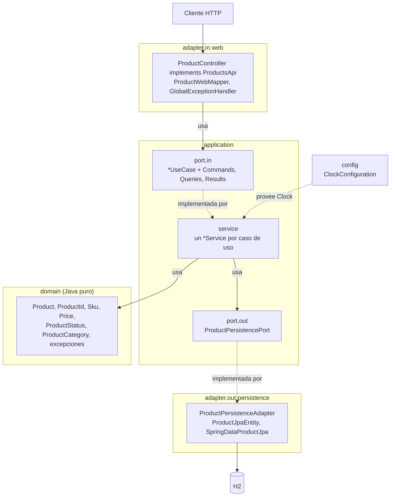
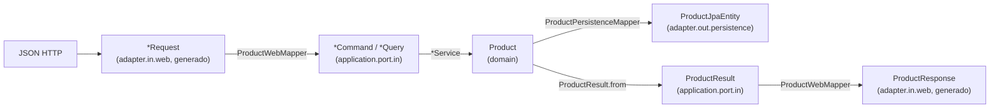

<!-- Generado con /documentar desde specs/ y src/. No editar a mano: cambia la spec y regenera. -->

# Arquitectura

Fuentes: [architecture.md](../../specs/architecture/architecture.md),
[ADR-0001](../../specs/adr/0001-arquitectura-hexagonal.md) y el código en
[`src/main/java`](../../src/main/java/pe/edu/galaxy/training/java/sdd/catalog/).

## 1. Estilo

Es un monolito con **arquitectura hexagonal** (puertos y adaptadores). Las reglas del producto
(INV-01 a INV-11) viven en un dominio de Java puro que se prueba sin servidor ni base de datos
([ADR-0001](../../specs/adr/0001-arquitectura-hexagonal.md)).

## 2. Capas y regla de dependencia

| Capa / paquete | Responsabilidad | Puede depender de | Nunca depende de |
| :--- | :--- | :--- | :--- |
| `domain` | Modelo, reglas e invariantes, excepciones de dominio | nada | Spring, JPA, HTTP, `application`, `adapter` |
| `application.port.in` | Interfaces de casos de uso + Commands, Queries y Results | `domain` | `adapter` |
| `application.port.out` | Lo que la aplicación necesita del exterior | `domain` | `adapter` |
| `application.service` | Implementa `port.in`; orquesta dominio y `port.out` | `domain`, `port.in`, `port.out` | `adapter` |
| `adapter.in.web` | HTTP: DTO web, mapeo a Command, traducción de errores | `application.port.in`, `domain` (excepciones, `ProductStatus`, `ProductCategory`) | `application.service`, `adapter.out` |
| `adapter.out.persistence` | Implementa `port.out` con JPA | `application.port.out`, `domain` | `adapter.in` |
| `config` | Composition root: beans de configuración | todas | — (nadie depende de `config`) |

**Regla clave** ([architecture.md §2](../../specs/architecture/architecture.md)): el controlador solo conoce
las interfaces de `port.in` y el servicio solo conoce `port.out`. El dominio nunca sale de `application`:
el controlador recibe `ProductResult`, nunca `Product`.

## 3. Paquetes y clases

Raíz: `pe.edu.galaxy.training.java.sdd.catalog`. Esta tabla sale de recorrer `src/main/java` y coincide con
[architecture.md §5](../../specs/architecture/architecture.md).

| Paquete | Clases | Tipo |
| :--- | :--- | :--- |
| `domain.model` | [`Product`](../../src/main/java/pe/edu/galaxy/training/java/sdd/catalog/domain/model/Product.java) | Agregado raíz |
| | [`ProductId`](../../src/main/java/pe/edu/galaxy/training/java/sdd/catalog/domain/model/ProductId.java), [`Sku`](../../src/main/java/pe/edu/galaxy/training/java/sdd/catalog/domain/model/Sku.java), [`Price`](../../src/main/java/pe/edu/galaxy/training/java/sdd/catalog/domain/model/Price.java) | Objetos de valor (`record`) |
| | [`ProductStatus`](../../src/main/java/pe/edu/galaxy/training/java/sdd/catalog/domain/model/ProductStatus.java), [`ProductCategory`](../../src/main/java/pe/edu/galaxy/training/java/sdd/catalog/domain/model/ProductCategory.java) | `enum` |
| `domain.exception` | [`DomainException`](../../src/main/java/pe/edu/galaxy/training/java/sdd/catalog/domain/exception/DomainException.java) | Base abstracta con `details` |
| | `ProductValidationException`, `ProductNotFoundException`, `DuplicateSkuException`, `InvalidStateTransitionException`, `ProductIncompleteException` | Una por fila de ADR-0004 |
| `application.port.in.usecase` | `RegisterProductUseCase`, `UpdateProductUseCase`, `ActivateProductUseCase`, `DiscontinueProductUseCase`, `GetProductUseCase`, `SearchProductsUseCase` | `interface` |
| `application.port.in.command` | `RegisterProductCommand`, `UpdateProductCommand`, `ActivateProductCommand`, `DiscontinueProductCommand` | `record` |
| `application.port.in.query` | `GetProductQuery`, `SearchProductsQuery` | `record` |
| `application.port.in.result` | `ProductResult`, `ProductPageResult` | `record` |
| `application.port.out` | [`ProductPersistencePort`](../../src/main/java/pe/edu/galaxy/training/java/sdd/catalog/application/port/out/ProductPersistencePort.java) | `interface` |
| | `ProductPage` | `record` |
| `application.service` | `RegisterProductService`, `UpdateProductService`, `ActivateProductService`, `DiscontinueProductService`, `GetProductService`, `SearchProductsService` | `@Service` |
| `adapter.in.web` | [`ProductController`](../../src/main/java/pe/edu/galaxy/training/java/sdd/catalog/adapter/in/web/ProductController.java) | Implementa `ProductsApi` |
| | [`ProductWebMapper`](../../src/main/java/pe/edu/galaxy/training/java/sdd/catalog/adapter/in/web/ProductWebMapper.java) | DTO web ↔ Command/Query/Result |
| | [`GlobalExceptionHandler`](../../src/main/java/pe/edu/galaxy/training/java/sdd/catalog/adapter/in/web/GlobalExceptionHandler.java) | Excepción → `ErrorResponse` (ADR-0004, ADR-0007); relanza los errores propios de Spring MVC (ADR-0010) |
| | [`RejectExplicitNullsModule`](../../src/main/java/pe/edu/galaxy/training/java/sdd/catalog/adapter/in/web/RejectExplicitNullsModule.java), [`InvalidRequestException`](../../src/main/java/pe/edu/galaxy/training/java/sdd/catalog/adapter/in/web/InvalidRequestException.java) | ADR-0009 |
| `adapter.in.web.generated` | `ProductsApi` y los DTO del contrato | Generados (no se editan) |
| `adapter.out.persistence` | [`ProductPersistenceAdapter`](../../src/main/java/pe/edu/galaxy/training/java/sdd/catalog/adapter/out/persistence/ProductPersistenceAdapter.java) | Implementa `ProductPersistencePort` |
| | [`ProductJpaEntity`](../../src/main/java/pe/edu/galaxy/training/java/sdd/catalog/adapter/out/persistence/ProductJpaEntity.java) | Tabla `products`, SKU único |
| | `ProductPersistenceMapper`, `SpringDataProductJpa` | Mapeo y repositorio Spring Data |
| `config` | [`ClockConfiguration`](../../src/main/java/pe/edu/galaxy/training/java/sdd/catalog/config/ClockConfiguration.java) | Bean `Clock.systemUTC()` |

## 4. Modelos por frontera y flujo de una petición

Cada frontera tiene su propio modelo ([architecture.md §3](../../specs/architecture/architecture.md)).
Si cambia el contrato, solo cambia el adaptador web; si cambia la tabla, solo cambia el adaptador de persistencia.

1. **Request:** `ProductController` recibe el DTO generado (`RegisterProductRequest`, `UpdateProductRequest`,
   `DiscontinueProductRequest`). Las restricciones del contrato (formato, longitudes, `minProperties`, null
   explícito) se rechazan aquí con 400.
2. **Command o Query:** `ProductWebMapper` lo traduce y convierte los enums del contrato a los del dominio.
   La conversión es segura porque `spec_lint.py` comprueba que los valores coinciden.
3. **Product:** el servicio carga o crea el agregado y llama a su método (`register`, `update`, `activate`,
   `discontinue`), pasando el `Clock`. Las reglas INV se evalúan dentro de `Product`, `Sku` y `Price`.
4. **Entity:** `ProductPersistencePort.save` persiste a través de `ProductPersistenceAdapter`, que mapea a
   `ProductJpaEntity` y traduce la violación de SKU único a `DuplicateSkuException`.
5. **Result:** el servicio devuelve `ProductResult` (o `ProductPageResult`); el `Product` no sale de `application`.
6. **Response:** `ProductWebMapper` produce `ProductResponse` o `ProductPageResponse`. Si en cualquier paso se
   lanza una excepción, `GlobalExceptionHandler` la traduce a `ErrorResponse` ([api.md](api.md#errores)).
   Los errores propios de Spring MVC (404 de ruta, 405, 406, 415) conservan su HTTP (ADR-0010).

El diagrama de secuencia completo de `activateProduct` está en
[architecture.md §6](../../specs/architecture/architecture.md).

## 5. Puertos

| Puerto | Tipo | Operaciones |
| :--- | :--- | :--- |
| `RegisterProductUseCase` | in | `register(RegisterProductCommand): ProductResult` |
| `UpdateProductUseCase` | in | `update(UpdateProductCommand): ProductResult` |
| `ActivateProductUseCase` | in | `activate(ActivateProductCommand): ProductResult` |
| `DiscontinueProductUseCase` | in | `discontinue(DiscontinueProductCommand): ProductResult` |
| `GetProductUseCase` | in | `get(GetProductQuery): ProductResult` |
| `SearchProductsUseCase` | in | `search(SearchProductsQuery): ProductPageResult` |
| `ProductPersistencePort` | out | `save(Product)`, `findById(ProductId)`, `existsBySku(Sku)`, `search(status, category, page, size): ProductPage` |

En `search`, un filtro `null` significa "sin filtro" y `page` empieza en 0. El orden es el de RF-05:
`createdAt` ascendente y luego `id` ([architecture.md §4](../../specs/architecture/architecture.md)).

## 6. Ensamblaje y tiempo

Los servicios reciben un `java.time.Clock` inyectado y nunca llaman a `Instant.now()`. El bean
`Clock.systemUTC()` se declara en `config.ClockConfiguration`, y las pruebas lo reemplazan por un reloj fijo
([architecture.md §5](../../specs/architecture/architecture.md)).

Las transacciones terminan en la capa de aplicación (`@Transactional` en los servicios y
`spring.jpa.open-in-view=false` en [application.properties](../../src/main/resources/application.properties)).
