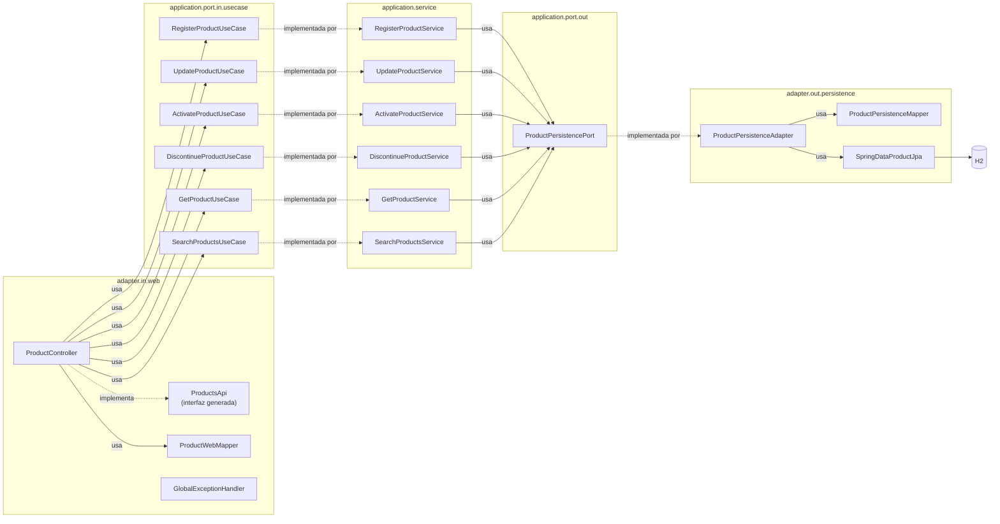
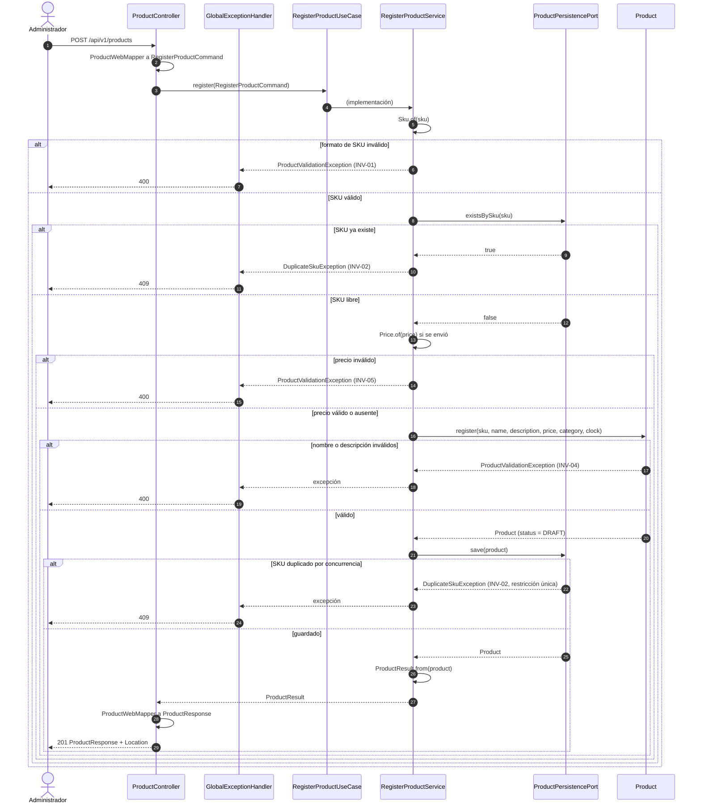
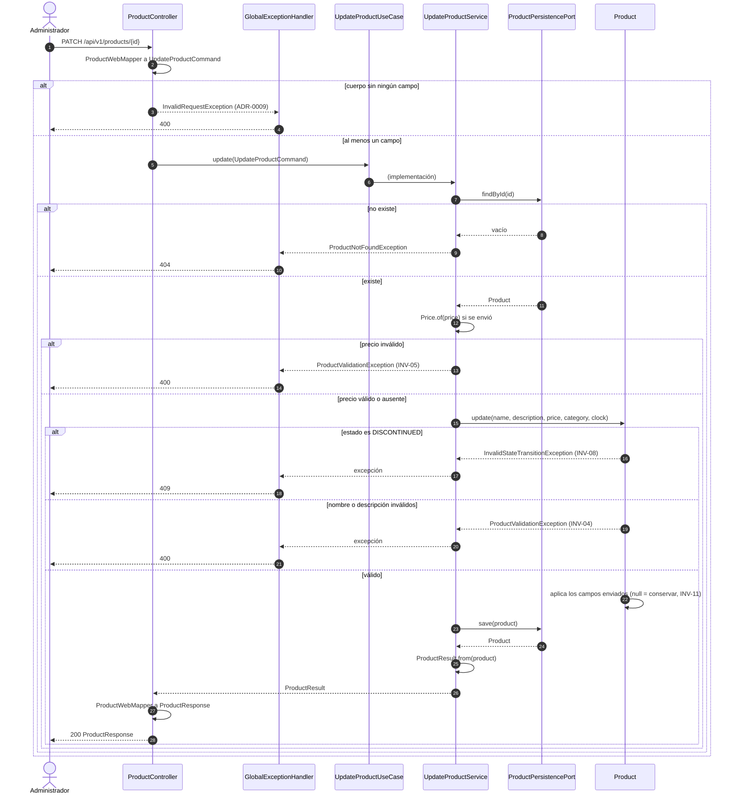
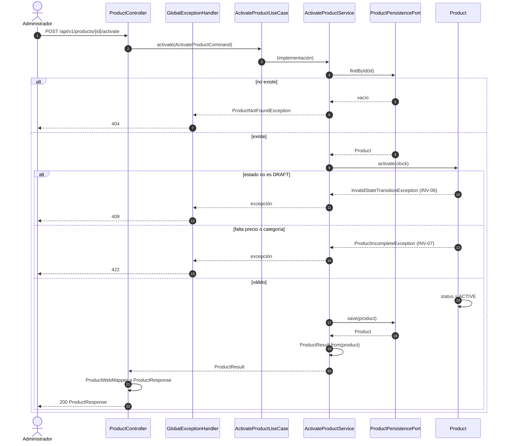
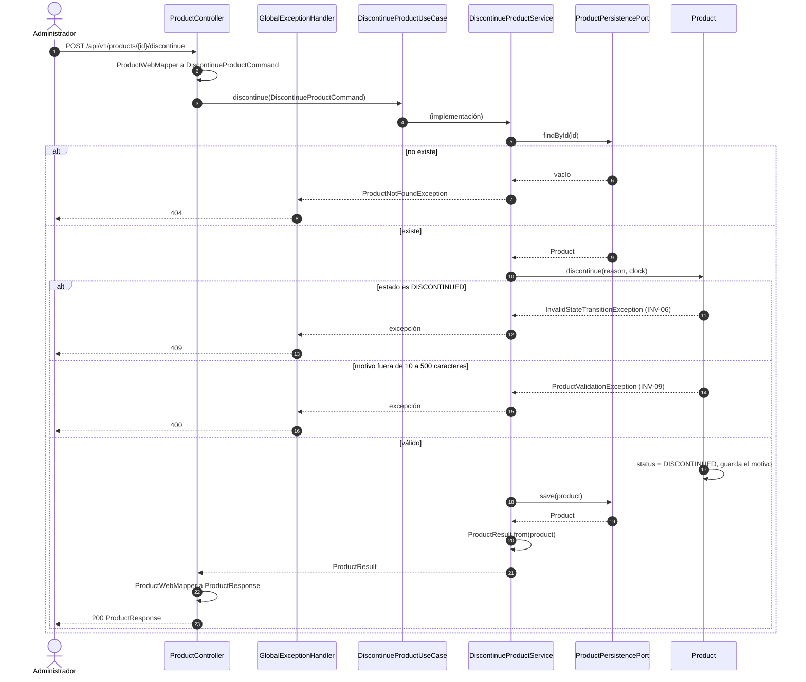
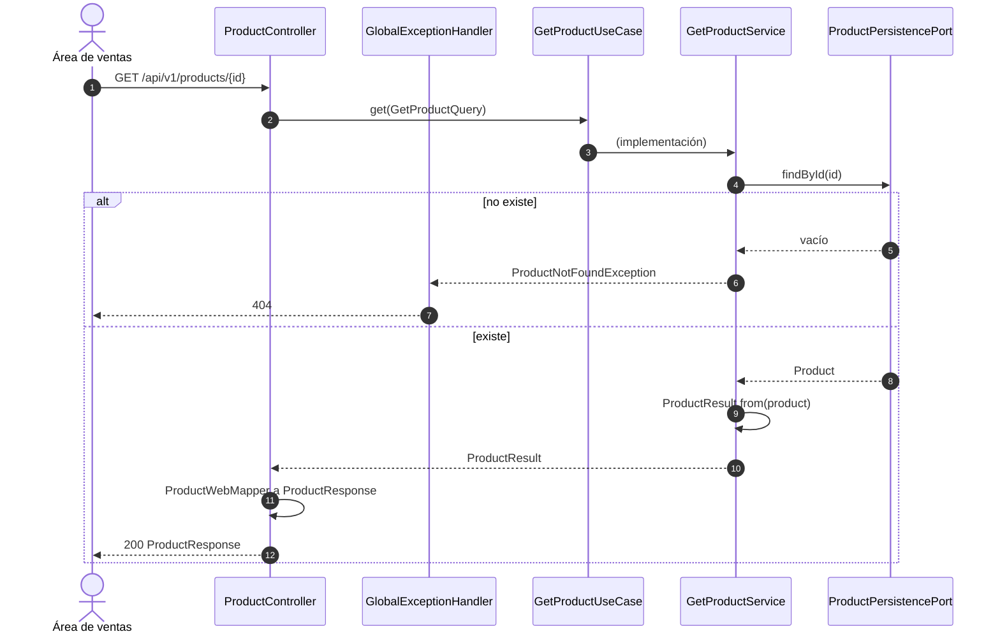
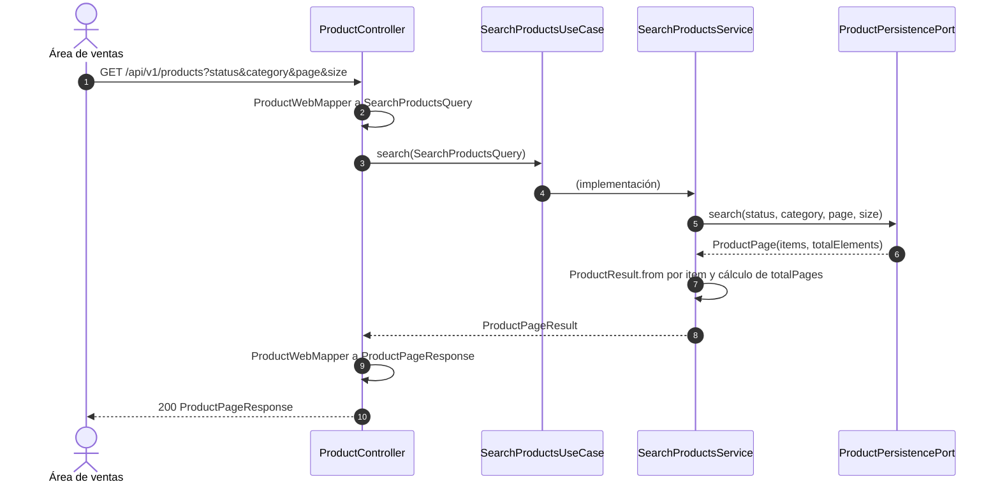

<!-- Generado con /diagramas desde specs/ y src/. No editar a mano: cambia la spec o el código y regenera. -->

# Diagramas por operación

Documentación derivada: un diagrama de secuencia por `operationId` del
[contrato](../../specs/api/catalog-openapi.yaml), con el formato de
[architecture.md §6](../../specs/architecture/architecture.md), y un diagrama de componentes
adaptador → puerto → servicio. Si contradicen una spec, manda la spec y este archivo se regenera.

Convenciones comunes a todas las secuencias:

- `GlobalExceptionHandler` traduce cada excepción a HTTP + `code` según
  [ADR-0004](../../specs/adr/0004-codigos-de-error.md).
- Los 400 por restricciones del contrato sobre los DTO generados (patrón, longitud, tipos, null
  explícito) los rechaza Spring antes de llegar al controlador ([ADR-0009](../../specs/adr/0009-null-explicito-en-requests.md),
  [ADR-0010](../../specs/adr/0010-errores-propios-de-spring-mvc.md)); no se repiten en cada diagrama.
- Cualquier error no previsto responde 500 `INTERNAL_ERROR` ([ADR-0007](../../specs/adr/0007-error-interno-generico.md)).

## Componentes: adaptador → puerto → servicio

## registerProduct (US01)

`POST /api/v1/products` · [operaciones/registerProduct.md](operaciones/registerProduct.md)

## updateProduct (US02)

`PATCH /api/v1/products/{productId}` · [operaciones/updateProduct.md](operaciones/updateProduct.md)

## activateProduct (US03)

`POST /api/v1/products/{productId}/activate` · [operaciones/activateProduct.md](operaciones/activateProduct.md)

## discontinueProduct (US04)

`POST /api/v1/products/{productId}/discontinue` · [operaciones/discontinueProduct.md](operaciones/discontinueProduct.md)

## getProduct (US05)

`GET /api/v1/products/{productId}` · [operaciones/getProduct.md](operaciones/getProduct.md)

## searchProducts (US05)

`GET /api/v1/products` · [operaciones/searchProducts.md](operaciones/searchProducts.md)

Un filtro ausente significa "sin filtro"; el orden de los resultados es el de RF-05
([architecture.md §4](../../specs/architecture/architecture.md)).
