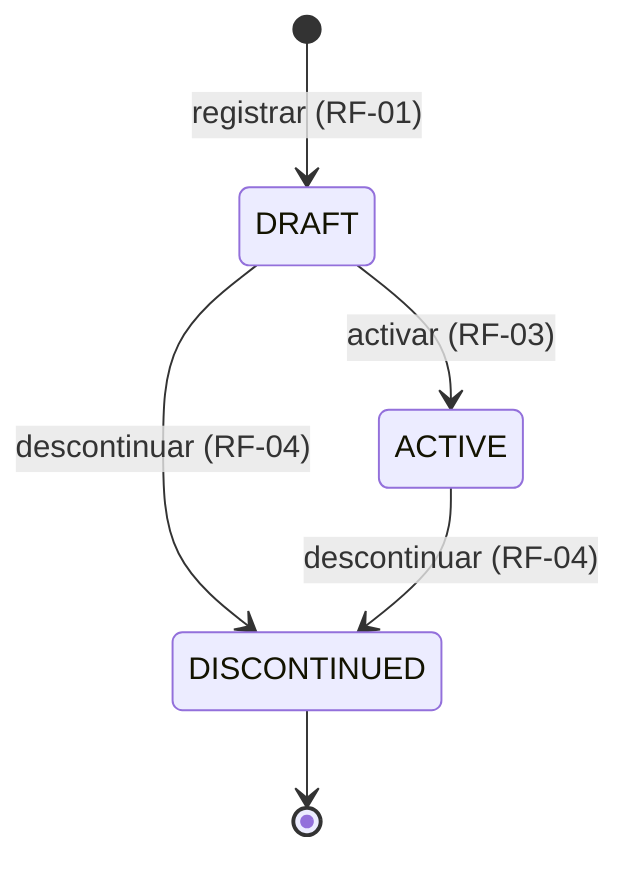
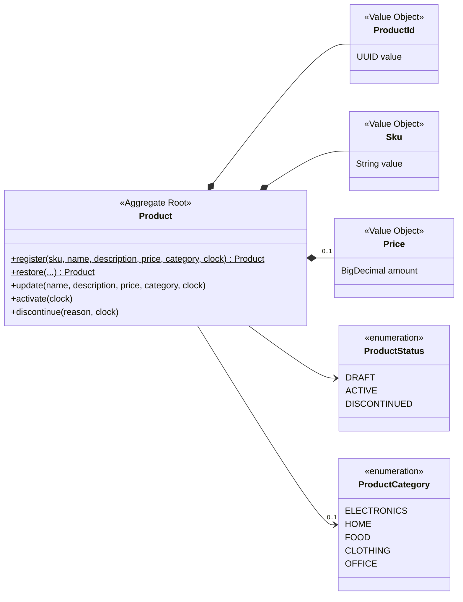

<!-- Generado con /documentar desde specs/ y src/. No editar a mano: cambia la spec y regenera. -->

# Dominio

Fuentes: [domain-model.md](../../specs/architecture/domain-model.md),
[product-lifecycle.md](../../specs/domain/product-lifecycle.md),
[catalogs.md](../../specs/domain/catalogs.md) y
[functional.md](../../specs/requirements/functional.md).

## 1. Glosario

| Término de negocio | Código | Definición |
| :--- | :--- | :--- |
| Producto | `Product` | Artículo del catálogo. Agregado principal. |
| Identificador | `ProductId` | Objeto de valor que envuelve un `UUID` generado por el sistema (ADR-0003). |
| SKU | `Sku` | Código de negocio del producto, formato `AAA-9999`, único e inmutable. |
| Precio | `Price` | Monto mayor a 0, máximo 2 decimales, en PEN. |
| Categoría | `ProductCategory` | Valor del catálogo cerrado. |
| Estado | `ProductStatus` | `DRAFT`, `ACTIVE`, `DISCONTINUED`. |
| Motivo de descontinuación | `discontinuationReason` | Texto obligatorio (10 a 500 caracteres) al descontinuar. |

## 2. Estados y transiciones

| Estado | Código | Descripción |
| :--- | :--- | :--- |
| Borrador | `DRAFT` | Producto registrado, aún no disponible para la venta. |
| Activo | `ACTIVE` | Producto completo y disponible para la venta. |
| Descontinuado | `DISCONTINUED` | Producto que ya no se ofrece. Estado final. |

La actualización de datos (RF-02) no cambia el estado. Cualquier transición no listada es inválida y se
rechaza con 409 `INVALID_STATE_TRANSITION`
([product-lifecycle.md §2](../../specs/domain/product-lifecycle.md)).
Cada transición es una operación propia (`activateProduct`, `discontinueProduct`), nunca un `PATCH` (ADR-0002).

## 3. Categorías

Catálogo cerrado: un valor fuera de él se rechaza con 400 `VALIDATION_ERROR`
([catalogs.md](../../specs/domain/catalogs.md)).

| Código | Descripción |
| :--- | :--- |
| `ELECTRONICS` | Electrónica y tecnología. |
| `HOME` | Hogar y decoración. |
| `FOOD` | Alimentos y bebidas. |
| `CLOTHING` | Ropa y accesorios. |
| `OFFICE` | Útiles y artículos de oficina. |

## 4. Modelo

El diagrama completo, con todos los atributos, está en
[domain-model.md §2](../../specs/architecture/domain-model.md).

## 5. Invariantes

| ID | Regla | Dónde se garantiza | Error (ADR-0004) | Criterios |
| :--- | :--- | :--- | :--- | :--- |
| INV-01 | El SKU tiene formato `AAA-9999`. | [`Sku`](../../src/main/java/pe/edu/galaxy/training/java/sdd/catalog/domain/model/Sku.java), al construirse | 400 `VALIDATION_ERROR` | US01 CA-03 |
| INV-02 | El SKU es único en el catálogo. | [`RegisterProductService`](../../src/main/java/pe/edu/galaxy/training/java/sdd/catalog/application/service/RegisterProductService.java) con `existsBySku`; la respalda la restricción única de [`ProductJpaEntity`](../../src/main/java/pe/edu/galaxy/training/java/sdd/catalog/adapter/out/persistence/ProductJpaEntity.java), que el adaptador traduce a `DuplicateSkuException` | 409 `DUPLICATE_SKU` | US01 CA-02 |
| INV-03 | El SKU nunca cambia. | [`Product`](../../src/main/java/pe/edu/galaxy/training/java/sdd/catalog/domain/model/Product.java): campo `final` sin método que lo cambie | — (el SKU no está en `UpdateProductRequest`) | US02 CA-03 |
| INV-04 | Nombre de 3 a 100 caracteres; descripción de máximo 500 (medidos y guardados sin espacios al inicio y al final). | `Product` | 400 `VALIDATION_ERROR` | US01 CA-01, US02 CA-04 |
| INV-05 | Precio mayor a 0 y máximo 2 decimales, sin contar ceros finales (`10.500` válido, `10.505` no). | [`Price`](../../src/main/java/pe/edu/galaxy/training/java/sdd/catalog/domain/model/Price.java), al construirse | 400 `VALIDATION_ERROR` | US01 CA-04 |
| INV-06 | Solo se permiten las transiciones de `product-lifecycle.md`. | `Product.activate()` / `discontinue()` | 409 `INVALID_STATE_TRANSITION` | US03 CA-03, US04 CA-03 |
| INV-07 | Para activar se requiere precio y categoría. | `Product.activate()` | 422 `PRODUCT_INCOMPLETE` (con los datos faltantes en `details`) | US03 CA-02 |
| INV-08 | Un producto descontinuado no se modifica. | `Product.update()` | 409 `INVALID_STATE_TRANSITION` | US02 CA-02 |
| INV-09 | Descontinuar exige motivo de 10 a 500 caracteres (medidos y guardados sin espacios al inicio y al final). | `Product.discontinue()` | 400 `VALIDATION_ERROR` | US04 CA-02 |
| INV-10 | Un producto nunca se elimina. | No existe operación de borrado: ni en el contrato ni en `ProductPersistencePort` | — | US04 CA-04 |
| INV-11 | Precio y categoría no pueden eliminarse una vez informados. | `Product.update()` (null = conservar el valor); el null explícito lo rechaza `adapter.in.web` antes de llegar al dominio (ADR-0009) | 400 `VALIDATION_ERROR` | US02 CA-05 |

Fuente de la tabla: [domain-model.md §3](../../specs/architecture/domain-model.md) y
[ADR-0004](../../specs/adr/0004-codigos-de-error.md).

## 6. Decisiones de modelado

Resumen de [domain-model.md §4](../../specs/architecture/domain-model.md):

- **Categoría como `enum`:** el catálogo es cerrado.
- **Unicidad del SKU en la aplicación:** un `Product` no conoce a los demás productos, así que INV-02 se valida
  en el servicio consultando el puerto de salida.
- **Dominio sin puertos:** solo modelo, reglas y excepciones; los puertos están en `application`.
- **Reconstitución:** `Product.restore(...)` reconstruye un producto guardado sin aplicar reglas de transición.
  Solo lo usa el adaptador de persistencia.
- **Tiempo:** los métodos que modifican el producto reciben un `Clock`, de modo que las pruebas controlan
  `createdAt` y `updatedAt`.
- **Recorte de espacios:** nombre, descripción y motivo se recortan antes de validarse y se guarda el valor
  recortado. Lo hace `Product`, no el adaptador web.
- **Actualización parcial:** en `Product.update(...)` un argumento `null` significa "no enviado" y conserva el
  valor actual. Por eso INV-11 se cumple por diseño.
