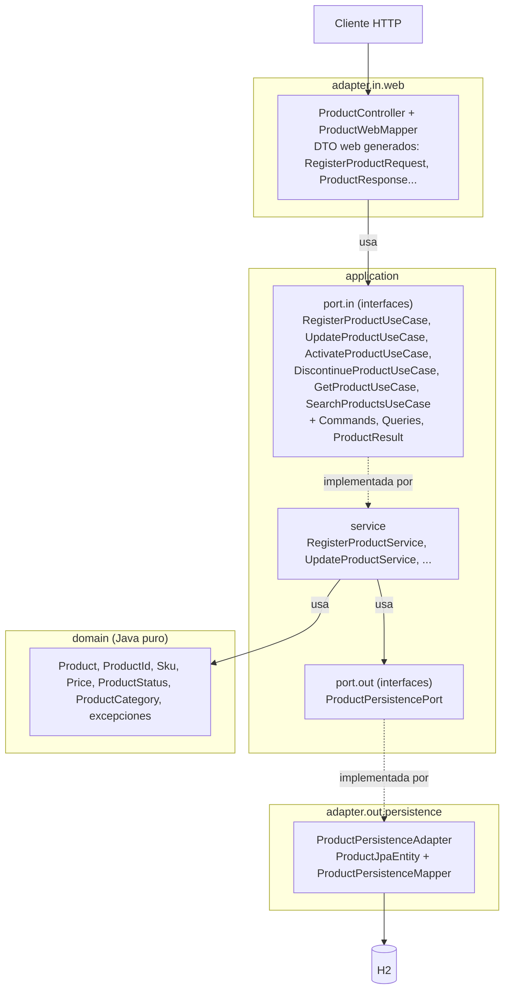
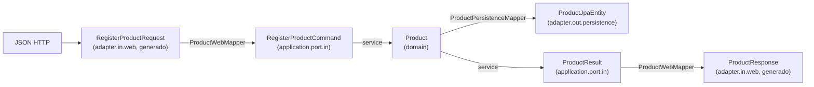
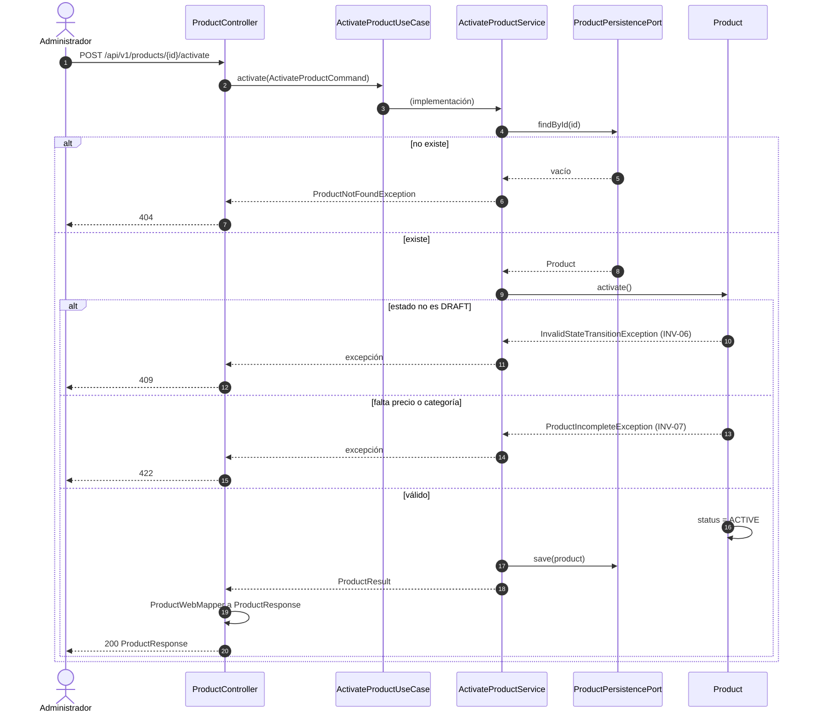

# Arquitectura - Catálogo de Productos

## 1. Estilo
Aplicación única (monolito) con **arquitectura hexagonal** (puertos y adaptadores).
Justificación en `adr/0001`.

**Stack:** ver `tech-stack.md`.

## 2. Capas y regla de dependencia



| Capa / paquete | Responsabilidad | Puede depender de | Nunca depende de |
| :--- | :--- | :--- | :--- |
| `domain` | Modelo, reglas e invariantes (INV-01 a INV-11), excepciones de dominio. | nada | Spring, JPA, HTTP, `application`, `adapter` |
| `application.port.in` | Interfaces de casos de uso + Commands, Queries y Results. | `domain` | `adapter` |
| `application.port.out` | Interfaces de lo que la aplicación necesita del exterior. | `domain` | `adapter` |
| `application.service` | Implementa `port.in`; orquesta dominio y `port.out`. | `domain`, `port.in`, `port.out` | `adapter` |
| `adapter.in.web` | HTTP: DTO web, mapeo a Command, traducción de errores. | `application.port.in` | `application.service`, `domain` (solo sus excepciones para mapear errores), `adapter.out` |
| `adapter.out.persistence` | Implementa `port.out` con JPA. | `application.port.out`, `domain` | `adapter.in` |

**Regla clave:** el controlador solo conoce las interfaces de `port.in`, nunca los servicios.
El servicio solo conoce `port.out`, nunca el adaptador JPA.

## 3. Modelos de datos por frontera (DTO)

Cada frontera tiene su propio modelo; el dominio nunca sale de la aplicación.



| Modelo | Paquete | Tipo | Propósito |
| :--- | :--- | :--- | :--- |
| `RegisterProductRequest`, `UpdateProductRequest`, `DiscontinueProductRequest`, `ProductResponse`, `ProductPageResponse` | `adapter.in.web` (generados) | DTO web | Forma exacta del contrato OpenAPI. |
| `RegisterProductCommand`, `UpdateProductCommand`, `ActivateProductCommand`, `DiscontinueProductCommand` | `application.port.in` | `record` | Entrada de casos de uso de escritura. |
| `GetProductQuery`, `SearchProductsQuery` | `application.port.in` | `record` | Entrada de casos de uso de lectura. |
| `ProductResult`, `ProductPageResult` | `application.port.in` | `record` | Salida de los casos de uso (nunca se expone `Product`). |
| `ProductJpaEntity` | `adapter.out.persistence` | Entidad JPA | Forma de la tabla. |

**Por qué tantos modelos:** si cambia el contrato, solo cambia el adaptador web; si cambia la tabla,
solo el adaptador de persistencia. El dominio queda protegido de ambos cambios.

## 4. Puertos

| Puerto | Tipo | Operaciones | Historia |
| :--- | :--- | :--- | :--- |
| `RegisterProductUseCase` | in | `register(RegisterProductCommand): ProductResult` | US01 |
| `UpdateProductUseCase` | in | `update(UpdateProductCommand): ProductResult` | US02 |
| `ActivateProductUseCase` | in | `activate(ActivateProductCommand): ProductResult` | US03 |
| `DiscontinueProductUseCase` | in | `discontinue(DiscontinueProductCommand): ProductResult` | US04 |
| `GetProductUseCase` | in | `get(GetProductQuery): ProductResult` | US05 |
| `SearchProductsUseCase` | in | `search(SearchProductsQuery): ProductPageResult` | US05 |
| `ProductPersistencePort` | out | `save`, `findById`, `existsBySku`, `search` | US01–US05 |

Firmas de `ProductPersistencePort` (solo usa tipos de `domain` y de `port.out`):

| Operación | Firma | Notas |
| :--- | :--- | :--- |
| `save` | `save(Product): Product` | Inserta o actualiza. Una violación de unicidad del SKU se traduce a `DuplicateSkuException` (INV-02). |
| `findById` | `findById(ProductId): Optional<Product>` | |
| `existsBySku` | `existsBySku(Sku): boolean` | |
| `search` | `search(ProductStatus status, ProductCategory category, int page, int size): ProductPage` | Un filtro `null` significa "sin filtro". `page` empieza en 0. Orden de RF-05. |

`ProductPage(List<Product> items, long totalElements)` es un `record` de `application.port.out`:
el puerto de salida no puede devolver `ProductPageResult`, que pertenece a `port.in`.

Un servicio por caso de uso (`RegisterProductService implements RegisterProductUseCase`, etc.):
cada clase se rastrea a una sola historia.

## 5. Estructura de paquetes

```text
pe.edu.galaxy.training.java.sdd.catalog
├── domain
│   ├── model            # Product, ProductId, Sku, Price, ProductStatus, ProductCategory
│   └── exception        # ProductValidationException, ProductNotFoundException, DuplicateSkuException,
│                        # InvalidStateTransitionException, ProductIncompleteException (una por fila de ADR-0004)
├── application
│   ├── port
│   │   ├── in           # *UseCase + Commands, Queries, Results
│   │   └── out          # ProductPersistencePort, ProductPage
│   └── service          # *Service (implementan port.in)
└── adapter
    ├── in
    │   └── web          # ProductController, ProductWebMapper, GlobalExceptionHandler
    │       └── generated# DTO e interfaz generados del contrato (no editar)
    └── out
        └── persistence  # ProductPersistenceAdapter, ProductJpaEntity, ProductPersistenceMapper, SpringDataProductJpa
```

**Hora actual:** los servicios reciben un `java.time.Clock` inyectado (nunca `Instant.now()`).
El bean `Clock` (`Clock.systemUTC()`) se declara en `CatalogoProductosApplication`; las pruebas lo reemplazan
por un reloj fijo. No se crea un paquete `config`.

## 6. Flujo de ejemplo: activar producto (US03)



Las reglas (INV-06, INV-07) se evalúan dentro de `Product`; el servicio orquesta y el controlador solo traduce.
Los códigos HTTP son una propuesta; se confirman al diseñar el contrato.