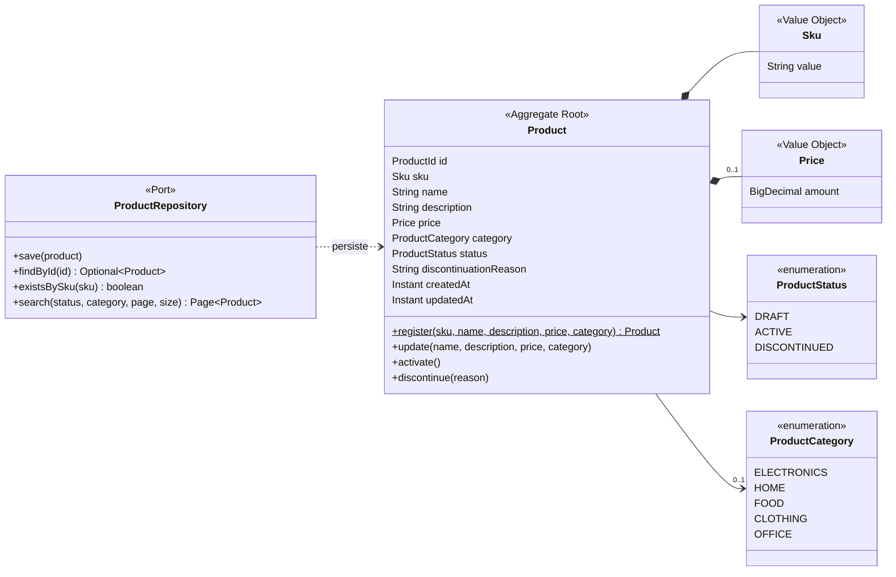

# Modelo de Dominio - Catálogo de Productos

Organiza en objetos las reglas de `requirements/`, `domain/` y `user-stories/`.
No introduce reglas nuevas: si una regla no tiene fuente, primero se agrega a la spec.

## 1. Glosario (lenguaje ubicuo)

| Término de negocio | Código | Definición |
| :--- | :--- | :--- |
| Producto | `Product` | Artículo del catálogo. Agregado principal. |
| SKU | `Sku` | Código de negocio del producto, formato `AAA-9999`, único e inmutable. |
| Precio | `Price` | Monto mayor a 0, máximo 2 decimales, en PEN. |
| Categoría | `ProductCategory` | Valor del catálogo cerrado (`domain/catalogs.md`). |
| Estado | `ProductStatus` | `DRAFT`, `ACTIVE`, `DISCONTINUED` (`domain/product-lifecycle.md`). |
| Motivo de descontinuación | `discontinuationReason` | Texto obligatorio (mín. 10) al descontinuar. |

## 2. Diagrama de clases



## 3. Invariantes

| ID | Regla | Dónde se garantiza | Fuente | Criterios |
| :--- | :--- | :--- | :--- | :--- |
| INV-01 | El SKU tiene formato `AAA-9999`. | `Sku` (al construirse) | RF-01 | US01 CA-03 |
| INV-02 | El SKU es único en el catálogo. | Caso de uso de registro (vía `ProductRepository.existsBySku`) | RF-01 | US01 CA-02 |
| INV-03 | El SKU nunca cambia. | `Product` (no expone método para cambiarlo) | RF-01, RF-02 | US02 CA-03 |
| INV-04 | Nombre de 3 a 100 caracteres; descripción de máx. 500. | `Product` | RF-01, RF-02 | US01 CA-01, US02 CA-04 |
| INV-05 | Precio mayor a 0 y máximo 2 decimales. | `Price` (al construirse) | RF-01 | US01 CA-04 |
| INV-06 | Solo se permiten las transiciones de `product-lifecycle.md`. | `Product.activate()` / `discontinue()` | lifecycle §2 | US03 CA-03, US04 CA-03 |
| INV-07 | Para activar se requiere precio y categoría. | `Product.activate()` | RF-03 | US03 CA-02 |
| INV-08 | Un producto descontinuado no se modifica. | `Product.update()` | RF-02, RF-04 | US02 CA-02 |
| INV-09 | Descontinuar exige motivo de al menos 10 caracteres. | `Product.discontinue()` | RF-04 | US04 CA-02 |
| INV-10 | Un producto nunca se elimina. | No existe operación de borrado | RF-04 | US04 CA-04 |

## 4. Decisiones de modelado
- **La categoría es un enum y no un Value Object:** el catálogo es cerrado; si fuera administrable, sería una entidad.
- **La unicidad del SKU (INV-02) no puede validarla `Product` solo:** un objeto no conoce a los demás productos. Por eso se valida en el caso de uso, consultando el repositorio.
- **`ProductRepository` es un puerto:** el dominio define *qué* necesita (guardar, buscar) sin saber *cómo* se implementa (base de datos, memoria). Se detalla en la arquitectura.

```
git add specs/architecture/domain-model.md
git commit -m "design: modelo de dominio del producto con invariantes INV-01 a INV-10"

```