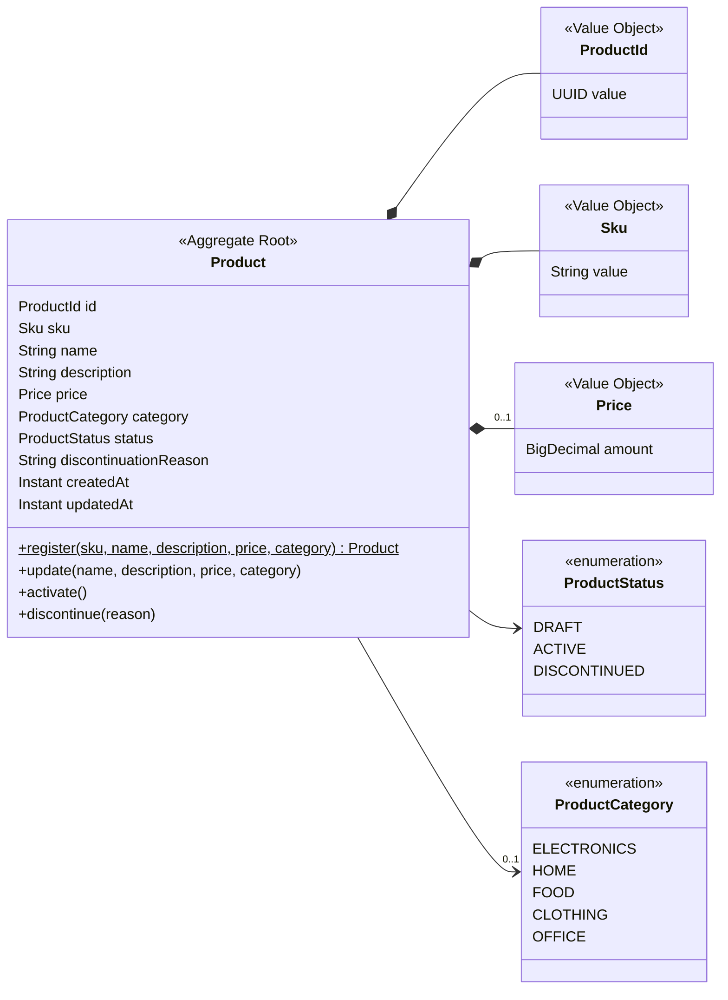

# Modelo de Dominio - Catálogo de Productos

Organiza en objetos las reglas de `requirements/`, `domain/` y `user-stories/`.
No introduce reglas nuevas: si una regla no tiene fuente, primero se agrega a la spec.

## 1. Glosario (lenguaje ubicuo)

| Término de negocio | Código | Definición |
| :--- | :--- | :--- |
| Producto | `Product` | Artículo del catálogo. Agregado principal. |
| Identificador | `ProductId` | Objeto de valor que envuelve un `UUID` generado por el sistema (ADR-0003). |
| SKU | `Sku` | Código de negocio del producto, formato `AAA-9999`, único e inmutable. |
| Precio | `Price` | Monto mayor a 0, máximo 2 decimales, en PEN. |
| Categoría | `ProductCategory` | Valor del catálogo cerrado (`domain/catalogs.md`). |
| Estado | `ProductStatus` | `DRAFT`, `ACTIVE`, `DISCONTINUED` (`domain/product-lifecycle.md`). |
| Motivo de descontinuación | `discontinuationReason` | Texto obligatorio (10 a 500 caracteres) al descontinuar. |

## 2. Diagrama de clases

## 3. Invariantes

| ID | Regla | Dónde se garantiza | Fuente | Criterios |
| :--- | :--- | :--- | :--- | :--- |
| INV-01 | El SKU tiene formato `AAA-9999`. | `Sku` (al construirse) | RF-01 | US01 CA-03 |
| INV-02 | El SKU es único en el catálogo. | `RegisterProductService` (application), consultando `ProductPersistencePort.existsBySku` | RF-01 | US01 CA-02 |
| INV-03 | El SKU nunca cambia. | `Product` (no expone método para cambiarlo) | RF-01, RF-02 | US02 CA-03 |
| INV-04 | Nombre de 3 a 100 caracteres; descripción de máx. 500 (medidos y guardados sin espacios al inicio y al final). | `Product` | RF-01, RF-02 | US01 CA-01, US02 CA-04 |
| INV-05 | Precio mayor a 0 y máximo 2 decimales, sin contar ceros finales (`10.500` válido, `10.505` no). | `Price` (al construirse) | RF-01 | US01 CA-04 |
| INV-06 | Solo se permiten las transiciones de `product-lifecycle.md`. | `Product.activate()` / `discontinue()` | lifecycle §2 | US03 CA-03, US04 CA-03 |
| INV-07 | Para activar se requiere precio y categoría. | `Product.activate()` | RF-03 | US03 CA-02 |
| INV-08 | Un producto descontinuado no se modifica. | `Product.update()` | RF-02, RF-04 | US02 CA-02 |
| INV-09 | Descontinuar exige motivo de 10 a 500 caracteres (medidos y guardados sin espacios al inicio y al final). | `Product.discontinue()` | RF-04 | US04 CA-02 |
| INV-10 | Un producto nunca se elimina. | No existe operación de borrado | RF-04 | US04 CA-04 |
| INV-11 | Precio y categoría no pueden eliminarse una vez informados (un producto activo siempre está completo). | `Product.update()` | RF-02, visión §1 | US02 CA-05 |

## 4. Decisiones de modelado
- **La categoría es un enum y no un Value Object:** el catálogo es cerrado; si fuera administrable, sería una entidad.
- **La unicidad del SKU (INV-02) no puede validarla `Product` solo:** un objeto no conoce a los demás productos. Se valida en el servicio de aplicación, consultando el puerto de salida.
- **El dominio no contiene puertos ni conoce la persistencia:** solo modelo, reglas y excepciones de dominio. Los puertos se definen en `application` (ver `architecture.md`).
- **Reconstitución:** `Product.restore(...)` reconstruye un producto ya guardado (id, estado, fechas) sin aplicar reglas de transición. Lo usa solo el adaptador de persistencia.
- **Tiempo:** los métodos que modifican el producto reciben un `java.time.Clock` para fijar `createdAt` y `updatedAt`, de modo que las pruebas controlan el tiempo.
- **Recorte de espacios:** nombre, descripción y motivo de descontinuación se recortan (espacios al inicio y al final) antes de validarse, y se guarda el valor recortado (`"  Laptop "` se guarda como `"Laptop"`). Lo hace `Product`, no el adaptador web.
- **Actualización parcial:** en `Product.update(...)`, un argumento `null` significa "no enviado": se conserva el valor actual. Por eso no hay forma de quitar precio, categoría ni descripción una vez informados (INV-11 se cumple por diseño); el contrato rechaza `null` explícito con 400.
