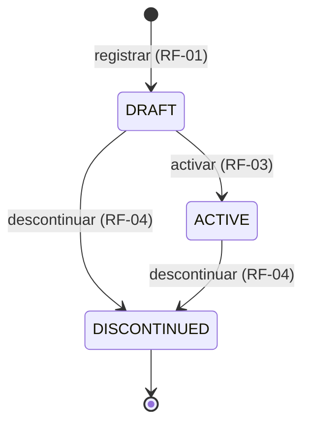

# Ciclo de Vida del Producto

Fuente única de verdad de los estados del producto. Cualquier estado usado en requerimientos,
historias, contrato o código debe ser uno de los definidos aquí.

## 1. Estados

| Estado | Código | Descripción |
| :--- | :--- | :--- |
| Borrador | `DRAFT` | Producto registrado, aún no disponible para la venta. |
| Activo | `ACTIVE` | Producto completo y disponible para la venta. |
| Descontinuado | `DISCONTINUED` | Producto que ya no se ofrece. Estado final. |

## 2. Transiciones válidas

| Desde | Hacia | Disparador | Referencia |
| :--- | :--- | :--- | :--- |
| — | `DRAFT` | Registro del producto | RF-01 |
| `DRAFT` | `ACTIVE` | Activación (requiere precio y categoría) | RF-03 |
| `DRAFT` | `DISCONTINUED` | Descontinuación con motivo | RF-04 |
| `ACTIVE` | `DISCONTINUED` | Descontinuación con motivo | RF-04 |

La actualización de datos (RF-02) no cambia el estado.
Cualquier transición no listada es inválida y debe rechazarse.

## 3. Diagrama

